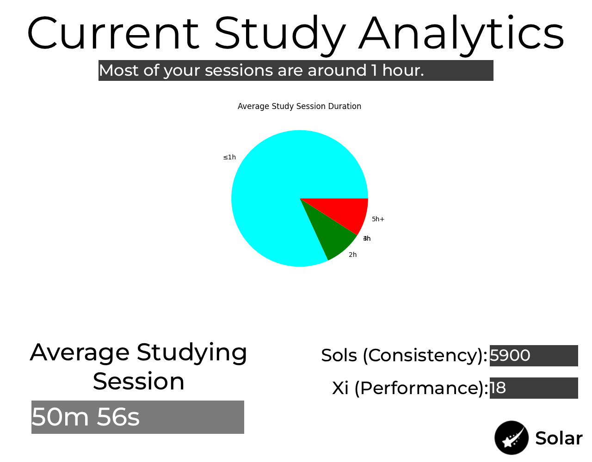
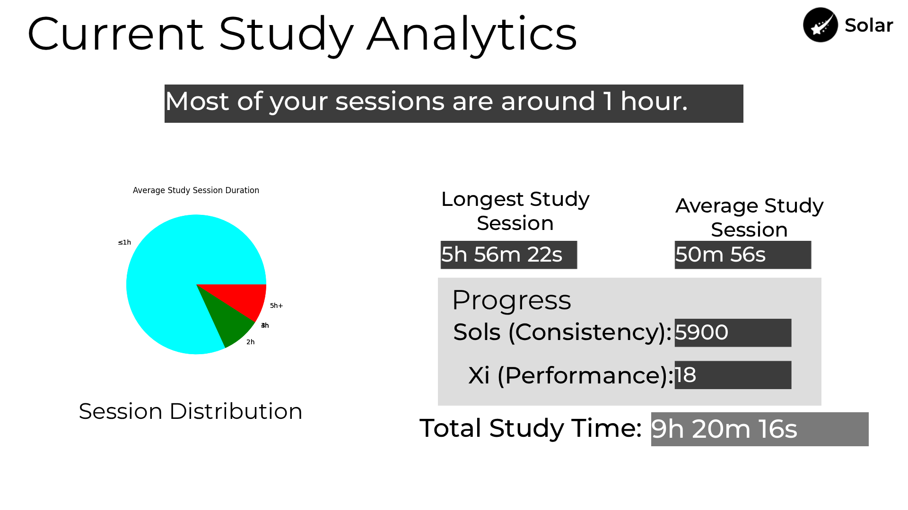

# Solar - A Study Tracker Bot

### Video Demo : click [here](https://youtu.be/LR8ksxi7WeQ)

## 🧩 The problem

Many students struggle to stay focused while studying, especially with distractions from social media such as Discord. Even when they attempt to focus, they might lose concentration over time. As a result, it is difficult to stay disciplined and/or track their study time efficiently.

Normal people may misunderstand this as **"laziness"**, when in reality it is largely influenced by constant distractions and a lack of structured focus. However, I see it as an opportunity to help these individuals overcome these challenges.

And may I present to you the alternative, **Solar**.

## 💡 The Idea

### So what is Solar? 
Solar is a Discord bot that revolves around study. Study bots have been part of the Discord community for a very long time. However, they are overlooked by most.

Solar aims to stand out from others with features for tracking study sessions, whereby the user starts a session and ends a session whenever they want.

Speaking about focus, the bot provides two modes for tracking study sessions. The first mode is called "standard" focus. In standard focus, the main goal is that you are only allowed to chat within a specific Discord channel; in this case, the system looks for a channel named `#study`. If the user chats in other channels that aren't called `#study`, the bot will end the study session. The same goes for being offline; the user is __NOT__ allowed to be offline. The bot will flag it as, "You're done with the study, I assume". 

The second focus mode is called "locked-in" focus. In this mode, it is basically the same as the standard focus, but the only catch is, you're not allowed to chat __AT ALL__.

In addition to focus tracking, it includes an analytics system. To briefly explain, with the analytics system, it displays the user's study session and shows the user their typical session duration.

## ⚙️ Core Features

The bot consists of five primary commands:

### Initiate/stop sessions
`/start [session-type]` - Starts the study session.
Parameters: `[session-type] -> "standard" or "locked-in"`

`/elapse` - Checks how long the user has been studying for.

`/stop`- Wraps up the user's study session.

### Others
`/analytics [display -> Optional]` - Shows the analytics of the user. If the display is not parsed in, then it will display a basic study summary [Figure 1.1](#figures). Otherwise, it will display a fully analyzed summary [Figure 1.2](#figures). Parameters: `[display -> "Advanced" or none]`

`/profile` - A simplified summary of the user's progress, displaying Sols (consistency) and Xi (performance).

### Less-used commands

`/settings [mode -> Optional] [bool -> Optional]` - Opens a setting menu. Solely made for me to debug code. Parameters: `[mode -> "dev mode" or none] & [bool -> Yes, no, or none]`

`/rquotes` - Gives you random quotes (made with API-Ninjas).


#### About Sols and Xi

They are designed to be like Reddit's [karma](https://support.reddithelp.com/hc/en-us/articles/204511829-What-is-karma) system. It shows your dedication to studying and is mainly used to show trustworthiness.

__So, what are the matters of Sols and Xi?__

Sols are earned based on study duration, with 50 Sols awarded every 5 minutes of continuous studying. This is equivalent to 10 Sols per minute.

Xi represents performance and is earned at a slower rate, with 1 Xi awarded every 30 minutes of studying.

#### Sols calculation

Sols are calculated by getting your session wrap-up time MINUS your starting time.

```∆T = end_time - start_time```

Where time is in seconds.

> [!Note]
> It takes 5 minutes of continuous studying to get 50 Sols (10 sols every minute).

It is then parsed into a computing function that calculates how many SOLs you are awarded.

#### Xi calculation
Xi is calculated by getting your session wrap-up time MINUS your starting time.

```∆T = end_time - start_time```

Where time is in seconds.
> [!Note]
> It takes 30 minutes of continuous studying to get 1 Xi.

It is then parsed into a computing function that calculates how many Xis you are awarded.

#### About the forgiving system
Some people may have studied for almost 30 minutes; this is why I introduced the Forgiving System. What this system does is basically check if the user has been studying within a 5-minute range that is within 30 minutes; that is, if the user studies at least 25 minutes, then they still get awarded with Xi.

## 🧠 Design Decisions
### Why not use Web-Application?
Part of the reason why I chose to use Discord and not a web application isn't because I don't like frontend and backend development, but because I generally prefer Discord due to how instant it is and my familiarity with it. I have always coded a Discord bot, and I am significantly more experienced with Discord bot development compared to building web applications. Another reason why I don't use the website is because it will be a lot harder to track your studies, and with the use of Discord's channels, I am able to track things more efficiently.

### Why strict session rules?
The main, and I mean main, reason why I must make session tracking strict is because you might cheat the system by just starting a study session, going offline for a few days, coming back, and stopping the study and flexing to your friends. Without strict rules, users may be able to exploit the system by leaving sessions running without actively studying. The enforced conditions ensure that recorded study time reflects genuine effort. This may sound ridiculous for a Discord bot to be this strict, but what I learned from CS50x is that you don't learn because someone always helped you; instead, you learn because you struggle.

### Why Sols and Xi instead of currency?
Part of it is because I like to use Reddit for general meme lookups and basically follow up on the current world. And no, I do NOT use X (formerly Twitter). Reddit has this karma system, which I really admired. It shows dedication of the user to the community. I basically borrowed the idea of karma and built Sols and Xi.

## 🧱 Technical Overview
In this project, I use Python as the main source of powerhouse. It is easy, and very powerful to use.

As you already saw in my code (I hope so), I use hikari as an alternative to discord.py due to its flexibility and event-driven design.

For database sakes (to store study sessions and more), I use sqlite3 that CS50x uses. The only difference, however, is I use the ACTUAL sqlite3 and not the CS50x's own implementation.

For analytics, I use matplotlib, numpy, and pillow. Matplotlib and numpy works together to create the graph visualization (as seen in the [Figure 1.1 and 1.2](#figures)), and pillow basically pastes that into the background template that is made externally via photoshop (as a png file).

## ⚠️ Challenges & Limitations
This project was developed with a limited timeframe of 11 days. Due to time constraints, I was unable to implement more advanced features such as an interactive dashboard system. As a result, this project was simplified to focus on delivering a smaller, but more concentrated set of well-polished, feature-rich commands.

## 🚀 Future Improvements
If I have enough time to improve the bot, this is what I would improve: 

- [ ] Add a web-based dashboard for visualization
- [ ] Add and expand the rewarding system
- [ ] Improve study-related commands' session logic.

## 🎯 Conclusion
Throughout this project, I developed a fully-functional Discord bot with data visualization. More significantly, it helps me reinforce the knowledge of designing applications with a clear structure, purpose, and most importantly, the importance of user experience.

## Figures
Figure 1.1


Figure 1.2
